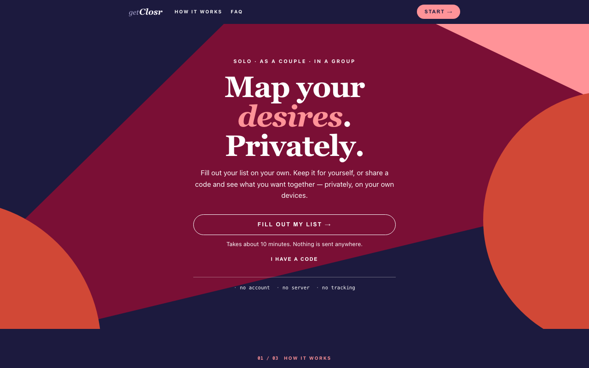

# getClosr

[](https://github.com/getclosr-link/getclosr/actions/workflows/tests.yml)

A free, private desires checklist for yourself, a partner, a date or a group. Each person fills out the list on their own device. Keep it for yourself, or share a code and the app shows what you want together. There is no account and no server: your answers stay in your browser until you decide to hand over a code.

Try it at **[getclosr.link](https://getclosr.link)**.



## How it works

1. Fill out your list. Rate each activity as No, Maybe, Yes or Crave, separately for doing it yourself, giving and receiving. It takes about 10 minutes, and you can switch off whole categories you don't want to think about today.
2. Generate a code. Your answers are packed into one compact code. The code is your data; nothing is stored anywhere else.
3. Compare. Paste each other's codes into the code field on the home screen. getClosr decodes them locally, shows what is inside, and then lists matches, things to talk about and gaps.

A comparison takes any number of people. With three or more, getClosr shows what everyone shares as well as each compatible pair, and never invents combinations that nobody chose.

## Sharing

Everything you can hand over sits in one share sheet, and each option says what it reveals before anything leaves the browser.

| Format | What it carries | Meant for |
|---|---|---|
| Profile card (PNG, 1080 × 1350) | Name, rating scale, category overview, a few Craves, the hard limits you chose to publish, and a QR code with your public profile | A dating profile, a forum post, your camera roll |
| Private code (v6) | Every rating, your activity notes, the overall note, opted-in aftercare and hard limits | One person you trust |
| Group code (v7) | Every list in a comparison | Reopening that comparison later, for example a couple's two lists |
| Comparison card (PNG) | Names, match, discuss and gap counts, how each pair overlaps | Sharing a summary without any notes |

The public profile behind the QR code never contains activity notes or the overall note. Hard limits appear on the card only because you wrote them for that purpose; the review screen counts them against a 280-byte limit so they fit in the QR code.

When someone scans your card, the code is taken out of the address bar as soon as it is read, so it does not stay in their browser history. It lands in the code field, where it describes itself before the visitor decides what to do with it.

Older v2 to v4 codes still open. Replacing your own list with an imported one is always a two-step confirmation after a preview; getClosr never merges or overwrites a list without asking.

## Features

- 10 categories with 64 activities, each with a short explanation; risky ones are marked "Needs context"
- Four-level rating scale (No, Maybe, Yes, Crave) for self, giving and receiving
- Private notes per activity and an overall note
- Aftercare preferences, shared only if you opt in
- Comparisons for any number of people, saved on the device
- Draft saved in `localStorage`, so a page refresh loses nothing
- Browser back and forward move between screens
- Dark design, mobile first

## Privacy

getClosr is one static HTML page. It has no backend, no database, no analytics, no cookies and no tracking. All processing happens in your browser, and we could not see your answers even if we wanted to.

There is one opt-in exception: the *Send feedback* button at the bottom of the page. Nothing loads until you click it. Then a small form opens, and only what you send leaves the browser: your message, the page address without query or code, your browser type and screen size. It never includes a screenshot, your answers or a code. The form talks to this site's own `/fk` path, which a Cloudflare Pages Function relays to the feedback gateway set in the `FEEDBACKKIT_ORIGIN` environment variable. Without that variable the form does not load at all. The open form also runs Cloudflare Turnstile as a bot check, the only request to a third party, and only after the click.

The full privacy policy is at [getclosr.link/privacy](https://getclosr.link/privacy).

## Local development

The app is a single file, [`public/index.html`](public/index.html), with no build step and no framework. Serve the `public/` folder with any static server:

```bash
cd public
python3 -m http.server 8000
```

Then open <http://localhost:8000>. The only vendored dependency is [qrcode-generator](https://github.com/kazuhikoarase/qrcode-generator) v2.0.4 (MIT), inlined so the QR code renders without a network request.

Design and wording rules live in [`docs/DESIGN.md`](docs/DESIGN.md) (the rating scale), [`docs/BRAND.md`](docs/BRAND.md) (voice and visuals) and [`docs/profile-card.md`](docs/profile-card.md) (the share card).

## Tests

The end-to-end tests use [Playwright](https://playwright.dev) and start their own server on port 4173:

```bash
cd tests
npm ci
npx playwright install chromium webkit
npm test
```

Every spec runs in Chromium. The sharing specs (profile card, group card, import and group comparison) also run in WebKit, because Safari handles sharing, the clipboard and canvas export differently. Use `npm run test:chromium` for a quicker run in Chromium only.

GitHub Actions runs the same suite on every pull request and on every push to `main` ([`.github/workflows/tests.yml`](.github/workflows/tests.yml)).

## Deployment

getClosr runs on Cloudflare Pages, connected to this repository: a push to `main` publishes the site. There is no build command, and the build output directory must be `public`. The headers in `public/_headers` (including `Cache-Control: no-store`) only apply when `public` is the deployed directory.

Check a deploy against the live domain rather than the build log, for example by comparing the byte size with your local file:

```bash
curl -sL https://getclosr.link/ | wc -c
wc -c public/index.html
```

A manual upload with `npx wrangler pages deploy public --project-name getclosr` creates a deployment, but on a git-connected project it does not take over the production domain.

## Contributing

Bug reports, ideas and pull requests are welcome. Please read [CONTRIBUTING.md](CONTRIBUTING.md) first; it covers the test run, the privacy rules for example data and how pull requests are reviewed. Everyone taking part agrees to the [code of conduct](CODE_OF_CONDUCT.md). Security problems go through the private channel described in [SECURITY.md](SECURITY.md), not a public issue.

## License

getClosr is free software under the [GNU Affero General Public License v3.0 only](LICENSE). If you run a modified version for other people, including as a website, you have to offer them its source code under the same license. Third-party code keeps its own license (qrcode-generator is MIT).

The checklist content (categories, activities, descriptions and questions) is also available under [CC BY-SA 4.0](LICENSE-CONTENT.md), so you can translate, print or reuse the list elsewhere as long as you credit getClosr and share your version alike.

Copyright © getClosr contributors

## Support

getClosr is free and has no subscription or ads. If it helped you, you can [buy me a coffee](https://buymeacoffee.com/madsbergstroem).

---

*SSC: Safe, Sane, Consensual · RACK: Risk-Aware Consensual Kink*

Made by the getClosr contributors.
